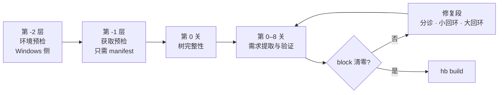

# OpenHarmony Build 检查流水线

**编译前预检：把构建失败从「编到一半炸」提前到「编之前就知道」。**

面对一个从没编译过的目标环境（新板卡、新架构、别人的服务器），你不知道它会在哪里炸。传统做法是「修一点、编一点」，一次编译几十分钟，几十次尝试才过得去。本项目不这么干——它读 `gn gen` 的生成物，把「这棵树声明了哪些需求」扫成一份清单，再去目标环境上逐条验证，在 `hb build` 之前把 `block` 级问题清零。

---

## STATUS：哪些能跑，哪些还是设计

**先看这张表再看别的** —— 这个仓库目前是**一套完整设计，还没有可运行的代码**。

| 部件                                  | 位置                                                  | 状态                                                                         |
| ------------------------------------- | ----------------------------------------------------- | ---------------------------------------------------------------------------- |
| 设计文档                              | [`docs/`](docs/)                                     | ✅ 7 篇，完整                                                                |
| 假源码树（离线自测用）                | [`tests/fixture/`](tests/fixture/)                   | ✅ 已落盘，6 个文件                                                          |
| 工具黑名单                            | [`rules/tool_denylist.txt`](rules/tool_denylist.txt) | ✅ 已落盘                                                                    |
| 第 -2 层：环境预检`p_env.py`        | —                                                    | ⬜ 设计完成（§16 / §26.6），未实现                                         |
| 第 -1 层：获取预检`p_fetch.py`      | —                                                    | ⬜ 设计完成（§26.6），未实现                                                |
| 第 -1 层：基线预检`p_base.py`       | —                                                    | ⬜ 设计完成（§26.6 / §26.7），未实现                                       |
| 第 0 关：树完整性                     | —                                                    | ⬜ 设计完成（[§18](docs/03-实现设计.md)），未实现                            |
| 七个提取器 S1–S7                     | —                                                    | ⬜ 设计完成（[§19](docs/03-实现设计.md)），未实现                            |
| 六个验证器`v_*`                     | —                                                    | ⬜ 设计完成（[§20](docs/03-实现设计.md)），未实现                            |
| 修复段（分诊 / 回环 / 回滚）          | —                                                    | ⬜ 设计完成（[§28](docs/06-修复段.md)），未实现                              |
| `rules/whitelist.yaml` 基线工具清单 | —                                                    | ⚠️**未落盘**：§26.7 说 `p_base.py` 的清单来自它，但清单本身还没定 |
| `coverage/expected.yaml` 覆盖率靶子 | —                                                    | ⚠️**未落盘**：§22 只写出 61 条里的 11 条                            |
| `rules/arch_map.yaml`               | —                                                    | ⚠️**未落盘**：§19.7 明确要求「对着树核一遍再落地，别照抄」          |

没有骨架代码、没有占位的空目录——**没实现的东西就只存在于文档里**。

> 第 -2 / -1 层曾有一个早期版本（探测环境 → `env.json` → 三态预检），它与 §16 / §26.6 的三模块拆分（`p_env` / `p_fetch` / `p_base`）结构对不上，且完全没有 manifest 端点探测那一层，**已判定为废案并移出本仓库**。

---

## 问题

冷启动。目标环境（新板卡、新架构、没编过的产品）上会踩哪些坑，事先答不出来；而每试一次，代价是几十次分钟。

## 破题

> 不要问「这个环境会遇到哪些问题」（答不出来），
> 要问「这棵树声明了哪些需求」（扫得出来）。

|                     | 传统做法           | 本方案                       |
| ------------------- | ------------------ | ---------------------------- |
| 检查的输入          | 失败经验           | 源码树里的**声明**     |
| 面对没见过的问题    | 清单里没有就查不出 | 规则只有七条，清单由扫描生成 |
| 61 条问题清单的作用 | 检查的输入         | **验收集 + 知识库**    |

三条不能违反的原则：

1. **提取规则是环境无关的。** 所以整套提取与知识库逻辑能在 Windows 上离线开发、离线自测，一次都不用连服务器。
2. **昂贵动作前置门。** 越贵的动作越晚做，但在它之前必须把能查的都查完（`repo sync`、补拉缺失仓、`hb build` 都是小时级）。
3. **检查从声明生成，不从失败生成。** 61 条问题是验收集，不是输入。

## 流水线一眼



产物是 `requirements.json`（需求清单）与 `findings.json`（定级 `block` / `warn` / `info`）。**出口条件不是 findings 清零，是 `block` 清零。**

---

## 快速开始

**暂时没有可运行的东西。** 设计完整，实现未开始——见上面的 STATUS 表。

唯一能离线演练的资产是 `tests/fixture/`（假树 6 个文件已落盘，断言清单在 [§21.2](docs/04-自测与验收.md)），但要等提取器实现出来才能真正跑起来。

从哪一步开始、每步的验收标准：见 [`docs/05-实施顺序与风险.md`](docs/05-实施顺序与风险.md)。

---

## 实现形态

**计划中，本体是一个命令行程序，不是 skill。**

这一点值得先说清楚，因为两者容易混：

|                                          | 是什么                                                    | 为什么是这个形态                                                                                                                                   |
| ---------------------------------------- | --------------------------------------------------------- | -------------------------------------------------------------------------------------------------------------------------------------------------- |
| **`src/` 下的程序**              | 普通 Python CLI，`scan.py --stage {env,fetch,tree,fix}` | 必须能**非交互地跑**——将来要挂在 `hb build` 前面，或者进 CI。不依赖 Claude Code 存在。                                                   |
| **`.claude/skills/` 下的 skill** | Agent 侧接口                                              | 设计里 §28 要求「每关一次 Agent 分诊」——把 findings + 知识库交给模型、收一个四选一的处置决定。这一步只有 Claude Code 做得了，纯 Python 做不了。 |

职责划分：**程序负责确定性的部分（扫描、验证、执行 recipe、回滚），skill 负责需要判断的部分（分诊、出候选修法）。**

> 两者都还没实现。`src/` 下目前是空的。

---

## 仓库导航

| 我想…                             | 去哪                                                      |
| ---------------------------------- | --------------------------------------------------------- |
| 一页看懂全貌                       | [`docs/00-总览.md`](docs/00-总览.md)                     |
| 看懂问题、方法和边界               | [`docs/01-问题与论证.md`](docs/01-问题与论证.md)         |
| 知道检查按什么顺序跑、为什么这么排 | [`docs/02-流水线与关.md`](docs/02-流水线与关.md)         |
| 知道提取器 / 验证器怎么写          | [`docs/03-实现设计.md`](docs/03-实现设计.md)             |
| 跑离线自测、看完备性验收实验       | [`docs/04-自测与验收.md`](docs/04-自测与验收.md)         |
| 知道先做哪一步、哪里会翻车         | [`docs/05-实施顺序与风险.md`](docs/05-实施顺序与风险.md) |
| 知道查出问题之后怎么办             | [`docs/06-修复段.md`](docs/06-修复段.md)                 |
| 看 61 条原始问题清单               | [`problems/`](problems/)                                 |

```
tool/
├── docs/            7 篇设计文档（为什么 + 怎么写）
├── tests/fixture/   假源码树，6 个文件，每个埋了一条已知故障
├── rules/           工具黑名单
├── problems/        61 条原始问题清单（验收集 + 知识库的原料）
└── [待建] src/      scan.py / precheck / lib / extractors / verifiers / fix
```

---

## 关于 `tests/fixture/`

一棵**手写的微型 OpenHarmony 树**，每个文件故意埋了一条已知故障（缺目录、revision 不符、`mcopy` 缺 `-o`、`uint32_t` 无 `<cstdint>`……）。

它成立的前提是原则一——**提取是环境无关的**。所以整套提取与知识库逻辑可以在 Windows 上开发、运行、验证，**一次都不用连服务器**；只有最后一关（拿真源码树跑覆盖率实验）需要上目标机。这是「提取规则是环境无关的」这句话的兑现。

断言清单见 [`docs/04-自测与验收.md`](docs/04-自测与验收.md)。

---

## 这套东西不做什么

- **不读源码**（半静态档：只读 `gn gen` 的生成物）
- **不跑构建**
- **不做破坏性探测**——所有探测全程只读。共享服务器上 `pkill` 会误杀他人进程，所以本工具用存在性检查，不做 kill 类探测
- **不追求 findings 清零**——只要求 `block` 清零；`warn` / `info` 留给人工判断

## 许可

MIT，见 [`LICENSE`](LICENSE)。
