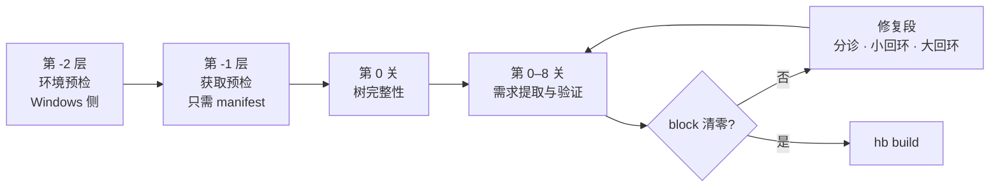

# OpenHarmony Build 检查流水线

**编译前预检：把构建失败从「编到一半炸」提前到「编之前就知道」。**

面对一个从没编译过的目标环境（新板卡、新架构、别人的服务器），你不知道它会在哪里炸。传统做法是「修一点、编一点」，一次编译几十分钟，几十次尝试才过得去。本项目不这么干——它扫一遍源码树，把「这棵树声明了哪些需求」读成一份清单，再去目标环境上逐条验证，在 `hb build` 之前把 `block` 级问题清零。

---

## STATUS：哪些能跑，哪些还是设计

**先看这张表再看别的** —— 这个仓库目前是**一套完整设计，还没有可运行的代码**。

| 部件                                  | 位置                                                     | 状态                                                                 |
| ------------------------------------- | -------------------------------------------------------- | -------------------------------------------------------------------- |
| 设计文档（问题 / 流水线 / 风险 / 分工） | [`docs/`](docs)                                        | ✅ 7 篇，完整（00–07）                                          |
| 设计文档（四层各怎么写）              | [`src/*/README.md`](src)                               | ✅ 5 篇，完整（`src/README.md` 是索引 + 四层各一篇）             |
| **数据契约**                    | [`schema/`](schema)                                    | ✅**3 份已冻结**——四层之间就靠这三份 JSON 交接            |
| 假源码树（离线自测用）                | [`tests/fixture/`](tests/fixture)                      | ✅ 已落盘，6 个文件                                                  |
| 工具黑名单                            | [`rules/tool_denylist.txt`](rules/tool_denylist.txt)    | ✅ 已落盘                                                            |
| **L1 扫描**                     | [`src/l1_scan/`](src/l1_scan)                          | ⬜ 设计完成（[本层 README](src/l1_scan/README.md)），未实现          |
| **L2 提取**（七个 S 任务）      | [`src/l2_extract/`](src/l2_extract)                    | ⬜ 设计完成（[本层 README](src/l2_extract/README.md)），未实现          |
| **L3 验证**（六个 `v_*`）    | [`src/l3_verify/`](src/l3_verify)                      | ⬜ 设计完成（[本层 README](src/l3_verify/README.md)），未实现          |
| **L4 判读与修改**               | [`src/l4_triage_fix/`](src/l4_triage_fix)              | ⏸️ **本轮先不管**（设计在 [本层 README](src/l4_triage_fix/README.md) + [`06`](docs/06-修复段.md)） |
| `common/`（多层共用）               | [`src/common/`](src/common)                            | ⬜ 未实现                                                            |
| 第 -2 / -1 层：两段预检               | [`src/precheck/`](src/precheck)                        | 🟡**有能跑的原型**（`.claude/skills/edge-deploy/`），待提上来 |
| `rules/whitelist.yaml` 基线工具清单 | —                                                       | ⚠️**未落盘**：`p_base.py` 的清单来自它，但清单本身还没定   |
| `coverage/expected.yaml` 覆盖率靶子 | —                                                       | ⚠️**未落盘**：§22 只写出 61 条里的 12 条                       |
| `rules/arch_map.yaml`               | —                                                       | ⚠️**未落盘**：§19.7 明确要求「对着树核一遍再落地，别照抄」     |

**每个 `src/` 子目录里现在只有一份 `README.md`——那不只是导航，它就是这一层的设计文档**（职责、输入输出、算法、已知边界都在里面）。**没有任何 `.py`**：没实现的东西不写成空壳，只存在于文档里。

> **本轮范围**：只做 **L1–L3**（扫描 → 提取 → 验证）。**L4 判读与修改先不动**——它的设计已经写完、放在原地，但这一轮不碰。理由：L1–L3 全只读、可离线自测；L4 是唯一有副作用的层，等前面三层跑通了再谈。

> 第 -2 / -1 层曾有一个早期版本（探测环境 → `env.json` → 三态预检），它与后来的三模块拆分（`p_env` / `p_fetch` / `p_base`，见 [`02` §26.6](docs/02-流水线与关.md)）结构对不上，且完全没有 manifest 端点探测那一层，**已判定为废案并移出本仓库**。

---

## 问题

冷启动。目标环境（新板卡、新架构、没编过的产品）上会踩哪些坑，事先答不出来；而每试一次，代价是几十次分钟。

## 破题

> 不要问「这个环境会遇到哪些问题」（答不出来），
> 要问「这棵树声明了哪些需求」（扫得出来）。

|                     | 传统做法           | 本方案                       |
| ------------------- | ------------------ | ---------------------------- |
| 检查的输入          | 失败经验           | 源码树里的**声明**     |
| 面对没见过的问题    | 清单里没有就查不出 | 规则只有七条，清单由扫描生成 |
| 61 条问题清单的作用 | 检查的输入         | **验收集 + 知识库**    |

三条不能违反的原则：

1. **提取规则是环境无关的。** 所以整套提取与知识库逻辑能在 Windows 上离线开发、离线自测，一次都不用连服务器。
2. **昂贵动作前置门。** 越贵的动作越晚做，但在它之前必须把能查的都查完（`repo sync`、补拉缺失仓、`hb build` 都是小时级）。
3. **检查从声明生成，不从失败生成。** 61 条问题是验收集，不是输入。

## 流水线一眼



产物是 `requirements.json`（需求清单）与 `findings.json`（定级 `block` / `warn` / `info`）。**出口条件不是 findings 清零，是 `block` 清零。**

---

## 快速开始

**暂时没有可运行的东西。** 设计完整，实现未开始——见上面的 STATUS 表。

唯一能离线演练的资产是 `tests/fixture/`（假树 6 个文件已落盘，断言清单在 [§21.2](docs/04-自测与验收.md)），但要等提取器实现出来才能真正跑起来。

从哪一步开始、每步的验收标准：见 [`docs/05-实施顺序与风险.md`](docs/05-实施顺序与风险.md)。

---

## 实现形态

**计划中，本体是一个命令行程序，不是 skill。**

这一点值得先说清楚，因为两者容易混：

|                                          | 是什么                                                    | 为什么是这个形态                                                                                                                                   |
| ---------------------------------------- | --------------------------------------------------------- | -------------------------------------------------------------------------------------------------------------------------------------------------- |
| **`src/` 下的程序**              | 普通 Python CLI，`scan.py --stage {env,fetch,tree,fix}` | 必须能**非交互地跑**——将来要挂在 `hb build` 前面，或者进 CI。不依赖 Claude Code 存在。                                                   |
| **`.claude/skills/` 下的 skill** | Agent 侧接口                                              | 设计里 [`06` §28.3](docs/06-修复段.md) 要求「每关一次 Agent 分诊」——把 findings + 知识库交给模型、收一个四选一的处置决定。这一步只有 Claude Code 做得了，纯 Python 做不了。 |

职责划分：**程序负责确定性的部分（扫描、验证、执行 recipe、回滚），skill 负责需要判断的部分（分诊、出候选修法）。** 这条线在代码上就是 `triage.py`（只产决定数据）和 `executor.py`（只消费决定执行）为什么是两个文件——[L4 §30.2](src/l4_triage_fix/README.md)。

> 两者都还没实现。`src/` 下目前只有每层的 `README.md`。

---

## 仓库导航

| 我想…                             | 去哪                                                                     |
| ---------------------------------- | ------------------------------------------------------------------------ |
| 一页看懂全貌                       | [`docs/00-总览.md`](docs/00-总览.md)                                     |
| 看懂问题、方法和边界               | [`docs/01-问题与论证.md`](docs/01-问题与论证.md)                         |
| 知道检查按什么顺序跑、为什么这么排 | [`docs/02-流水线与关.md`](docs/02-流水线与关.md)                         |
| 知道四层怎么切、每层吃什么吐什么   | [`docs/02` §29](docs/02-流水线与关.md)                                   |
| **看懂某一层怎么写**         | [`L1`](src/l1_scan/README.md) 扫描 · [`L2`](src/l2_extract/README.md) 提取 · [`L3`](src/l3_verify/README.md) 验证 · [`L4`](src/l4_triage_fix/README.md) 判读与修改（本轮先不管） |
| 知道数据长什么样（冻结的契约）     | [`schema/`](schema)                                                     |
| 跑离线自测、看完备性验收实验       | [`docs/04-自测与验收.md`](docs/04-自测与验收.md)                         |
| 知道先做哪一步、哪里会翻车         | [`docs/05-实施顺序与风险.md`](docs/05-实施顺序与风险.md)                 |
| 知道查出问题之后怎么办             | [`docs/06-修复段.md`](docs/06-修复段.md)                                 |
| **知道 L1–L3 四个人的活怎么切** | [`docs/07-分工.md`](docs/07-分工.md)                                     |
| 看 61 条原始问题清单               | [`problems/`](problems)                                                 |

```
tool/
├── docs/            7 篇设计文档（为什么 + 流水线怎么排 + 分工）
├── schema/          3 份数据契约——四层之间的交接面
├── src/             代码按四层分目录；实现设计就在各层的 README.md 里
│   ├── l1_scan/  l2_extract/  l3_verify/  l4_triage_fix/
│   └── common/   多层共用      precheck/  第 -2 / -1 层
├── tests/fixture/   假源码树，6 个文件，每个埋了一条已知故障
├── rules/           工具黑名单
├── problems/        61 条原始问题清单（验收集 + 知识库的原料）
└── [待建] scan.py   唯一入口（--stage {env,fetch,tree,fix}）
```

---

## 关于 `tests/fixture/`

一棵**手写的微型 OpenHarmony 树**，每个文件故意埋了一条已知故障（缺目录、revision 不符、`mcopy` 缺 `-o`、`uint32_t` 无 `<cstdint>`……）。

它成立的前提是原则一——**提取是环境无关的**。所以整套提取与知识库逻辑可以在 Windows 上开发、运行、验证，**一次都不用连服务器**；只有最后一关（拿真源码树跑覆盖率实验）需要上目标机。这是「提取规则是环境无关的」这句话的兑现。

断言清单见 [`docs/04-自测与验收.md`](docs/04-自测与验收.md)。

---

## 这套东西不做什么

- **不编译、不执行**——不跑 `hb build`，也不执行源码树里的任何脚本。对源码只做**静态文本分析**（读、分词、正则），不建 AST、不做语义解析
- **大部分不依赖 `gn gen`**——只有 2 条（`BUILD-027` / `BUILD-031`）需要 `gn gen` 之后的产物才能查，其余从源码树直接读（[`01` §11](docs/01-问题与论证.md)）
- **不做破坏性探测**——所有探测全程只读。共享服务器上 `pkill` 会误杀他人进程，所以本工具用存在性检查，不做 kill 类探测
- **不追求 findings 清零**——只要求 `block` 清零；`warn` / `info` 留给人工判断

## 许可

MIT，见 [`LICENSE`](LICENSE)。
