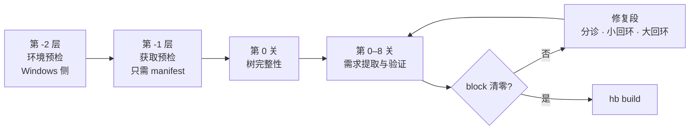

# 00 · 总览

> 一页说清这套东西是什么、要解决什么、仓库里各文件在哪。

## 这是什么

一套**编译前预检流水线**：在真正跑 `hb build` 之前，先查清「这棵树声明了哪些需求、目标环境满不满足」，把失败从构建中段（一次几十分钟）提前到构建之前（一次几秒钟）。

|                    |                                                                                                     |
| ------------------ | --------------------------------------------------------------------------------------------------- |
| **输入**     | `gn gen` 产出的生成物（`.ninja` / `args.gn` / `build.log`）+ 目标环境探测结果               |
| **不读**     | 源码（**半静态档**——「半」= 半程）                                                          |
| **不跑**     | 构建                                                                                                |
| **产出**     | `requirements.json`（需求清单）、`findings.json`（按 `block` / `warn` / `info` 三档定级） |
| **出口条件** | 不是 findings 清零，是**`block` 清零**                                                      |

## 要解决的问题

**冷启动**：面对一个从没编译过的目标环境（新板卡、新架构、别人的服务器），你不知道它会在哪里炸。传统做法是「修一点、编一点」——一次编译几十分钟，几十次尝试才过得去。

**破题**：不要问「这个环境会遇到哪些问题」（答不出来），要问「这棵树声明了哪些需求」（扫得出来）。

|                     | 传统做法         | 本方案                       |
| ------------------- | ---------------- | ---------------------------- |
| 检查的输入          | 失败经验         | 源码树里的**声明**     |
| 面对没见过的问题    | 表里没有就查不出 | 规则只有七条，清单由扫描生成 |
| 61 条问题清单的作用 | 检查的输入       | **验收集 + 知识库**    |

## 流水线一眼

逐关细节、修复段的两个回环与四条收敛判据、61 条逐条落点，见 [`02-流水线与关.md`](02-流水线与关.md)。

## 仓库导航

| 我想…                             | 去哪                                                                                                    |
| ---------------------------------- | ------------------------------------------------------------------------------------------------------- |
| 看懂问题和方法                     | [`01-问题与论证.md`](01-问题与论证.md)                                                                 |
| 知道检查按什么顺序跑、为什么这么排 | [`02-流水线与关.md`](02-流水线与关.md)                                                                 |
| 知道提取器 / 验证器怎么写          | [`03-实现设计.md`](03-实现设计.md)                                                                     |
| 跑一下自测                         | [`04-自测与验收.md`](04-自测与验收.md) + [`../tests/fixture/`](../tests/fixture/)                     |
| 知道先做哪一步、哪里会翻车         | [`05-实施顺序与风险.md`](05-实施顺序与风险.md)                                                         |
| 知道查出问题之后怎么办             | [`06-修复段.md`](06-修复段.md)                                                                         |
| 看现在有什么能跑的                 | 根[`README.md`](../README.md) 的 STATUS 表                                                             |
| 看 61 条原始问题清单               | [`../problems/OpenHarmony_Build问题六类重新归类.md`](../problems/OpenHarmony_Build问题六类重新归类.md) |

## 三条不能违反的原则

1. **提取规则是环境无关的。** 所以整套提取与知识库逻辑能在 Windows 上离线开发、离线自测，一次都不用连服务器——只有最后一关跑真源码树才需要目标环境。
2. **昂贵动作前置门。** 越贵的动作越晚做，但在它之前必须把能查的都查完（`repo sync`、补拉缺失仓、`hb build` 都是小时级）。
3. **检查从声明生成，不从失败生成。** 61 条问题是验收集和知识库，不是检查的输入。

## 与前身文档的关系

本项目的前身是 `OpenHarmony_Build六类问题_静态检查与修复设计.md`——那一份回答「**已知的每条问题怎么查**」（逐条，共 61 条），输入是**失败经验**。本仓库回答的是「**面对一个没编过的目标环境，怎么知道要查什么**」，输入是**源码树里的声明**。前身文档不在本仓库内。
