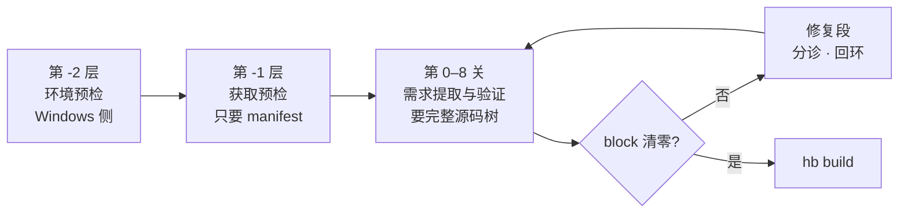
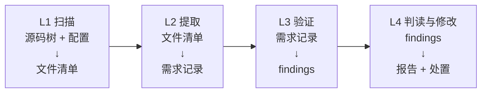

# 00 · 总览

> 一页说清：这是什么、怎么破题、**流水线**和**四层**分别长什么样。

[01 问题与论证 →](01-问题与论证.md)

---

## 这是什么

一套**编译前预检流水线**：在真正跑 `hb build` 之前，先查清「这棵树声明了哪些需求、目标环境满不满足」，把失败从构建中段（一次几十分钟）提前到构建之前（一次几秒钟）。

|                    |                                                                                                 |
| ------------------ | ----------------------------------------------------------------------------------------------- |
| **输入**     | 源码树 + `config.yaml` + 目标环境探测结果                                                       |
| **不跑**     | 构建——不执行 `hb build`，也不执行源码树里的任何脚本；对源码只做静态文本分析                     |
| **半静态档** | 只有 2 条（`BUILD-027`/`BUILD-031`）需要先 `gn gen`，其余从源码树直接读（[`01` §11](01-问题与论证.md)） |
| **产出**     | `requirements.json`（需求清单）、`findings.json`（按 `block`/`warn`/`info` 三档定级） |
| **出口条件** | 不是 findings 清零，是**`block` 清零**                                                        |

## 要解决的问题：冷启动

面对一个从没编译过的目标环境（新板卡、新架构、别人的服务器），**你不知道它会在哪里炸**。传统做法是「修一点、编一点」——一次编译几十分钟，几十次尝试才过得去。

难在哪：已有的检查全是从**已知失败**反推出来的，这带来一个循环依赖——

> 要跑检查，得先知道「这个环境会遇到哪些问题」；
> 要知道会遇到哪些问题，得先编译过；
> 可是编译正是我们想避免的。

换一个全新架构时这个问题最尖锐。**「再补几条检查」走不通**——补的是特例，换环境就失效。

## 破题

> 不要问「这个环境会遇到哪些问题」（答不出来），
> 要问「这棵树声明了哪些需求」（扫得出来）。

**构建失败，永远是「某个声明的要求没有被满足」。所以不该枚举失败，该枚举声明。**

|                     | 传统做法           | 本方案                       |
| ------------------- | ------------------ | ---------------------------- |
| 检查的输入          | 失败经验           | 源码树里的**声明**     |
| 面对没见过的问题    | 清单里没有就查不出 | 规则只有七条，清单由扫描生成 |
| 61 条问题清单的作用 | 检查的输入         | **验收集 + 知识库**    |

声明是**静态存在**的——编译只是去**验证**它们，不是去**产生**它们。所以**只要源码同步完了，就能生成检查清单，不需要编译过**。

## 三条不能违反的原则

1. **提取规则是环境无关的。** 所以整套提取与知识库逻辑能在 Windows 上离线开发、离线自测，一次都不用连服务器。
2. **昂贵动作前置门。** 越贵的动作越晚做，但在它之前必须把能查的都查完。
3. **检查从声明生成，不从失败生成。** 61 条问题是验收集，不是输入。

---

## 流水线一眼（横着切）

**三个昂贵动作，前面各有一道门。**

| 门                   | 跑在哪                  | 需要什么            | 保护谁                               |
| -------------------- | ----------------------- | ------------------- | ------------------------------------ |
| **第 -2 层**   | **Windows 侧**    | 什么都不要          | 装 WSL / 装工具（分钟级）            |
| **第 -1 层**   | WSL，**无源码树** | `repo` + manifest | `repo sync`（**小时级**）    |
| **第 0–8 关** | WSL，**有源码树** | 完整源码树          | 补拉缺失仓 +`hb build`（各小时级） |

关于检查按什么顺序排、每关查什么、为什么这么排，见 [`02-流水线与关.md`](02-流水线与关.md)。

## 四层一眼（竖着切）

**流水线的每一关内部，都走这四步。**

| 层                      | 输入          | 输出                         | 干什么                                                       |
| ----------------------- | ------------- | ---------------------------- | ------------------------------------------------------------ |
| **L1 扫描**       | 源码树 + 配置 | **文件清单**（带分类） | 遍历、排除、按后缀分类。机械动作                             |
| **L2 提取**       | 文件清单      | **需求记录**           | 按需求种类划分的若干任务，见 §29.2                          |
| **L3 验证**       | 需求记录      | **findings**（带证据） | 按验证原语划分的若干任务，见 §29.3                          |
| **L4 判读与修改** | findings      | **报告 + 处置决定**    | 定级、聚合、出口决定；**并把 findings 喂给 Agent，执行修复** |

**L1–L3 只读，L4 是唯一会改东西的层**——这条线一画，修复段为什么必须能单独关、为什么默认 dry-run、为什么只有它要回滚，就都归位了。

逐层细节、每个任务的输入输出，见 [`02-流水线与关.md`](02-流水线与关.md) 的 §29；每层落到哪些文件和目录，见 [`src/README.md`](../src/README.md)。

## 两条线什么关系

这两个切法**不冲突**，是同一件事的两个方向：

|                         | 是什么                       | 回答什么                         |
| ----------------------- | ---------------------------- | -------------------------------- |
| **流水线**（§7） | **横着切**——切成几关 | 什么时候跑、跑在哪、保护哪个动作 |
| **四层**（§29）  | **竖着切**——每关内部 | 一个任务吃进什么、吐出什么       |

**缺了竖的那一刀，每一关内部就是个黑盒**——只知道「第 0–8 关做需求提取与验证」，不知道里面怎么走。

---

## 仓库导航

| 我想…                           | 去哪                                                                                                    |
| -------------------------------- | ------------------------------------------------------------------------------------------------------- |
| 看懂问题和方法                   | [`01-问题与论证.md`](01-问题与论证.md)                                                                 |
| 知道检查按什么顺序跑、四层是什么 | [`02-流水线与关.md`](02-流水线与关.md)                                                                 |
| 知道**某一层**具体怎么写     | [`src/README.md`](../src/README.md) 是索引（共用地基）；分册 [`L1`](../src/l1_scan/README.md) / [`L2`](../src/l2_extract/README.md) / [`L3`](../src/l3_verify/README.md) / [`L4`](../src/l4_triage_fix/README.md) |
| 知道数据长什么样                 | [`../schema/`](../schema)                                                                              |
| 跑一下自测                       | [`04-自测与验收.md`](04-自测与验收.md) + [`../tests/fixture/`](../tests/fixture)                     |
| 知道先做哪一步、哪里会翻车       | [`05-实施顺序与风险.md`](05-实施顺序与风险.md)                                                         |
| 知道查出问题之后怎么办           | [`06-修复段.md`](06-修复段.md)                                                                         |
| 知道 L1–L3 四个人的活怎么切      | [`07-分工.md`](07-分工.md)                                                                             |
| 看现在有什么能跑的               | 根[`README.md`](../README.md) 的 STATUS 表                                                             |
| 看 61 条原始问题清单             | [`../problems/OpenHarmony_Build问题六类重新归类.md`](../problems/OpenHarmony_Build问题六类重新归类.md) |

## 与前身文档的关系

本项目的前身是 `OpenHarmony_Build六类问题_静态检查与修复设计.md`——那一份回答「**已知的每条问题怎么查**」（逐条，共 61 条），输入是**失败经验**。本仓库回答的是「**面对一个没编过的目标环境，怎么知道要查什么**」，输入是**源码树里的声明**。前身文档不在本仓库内。
