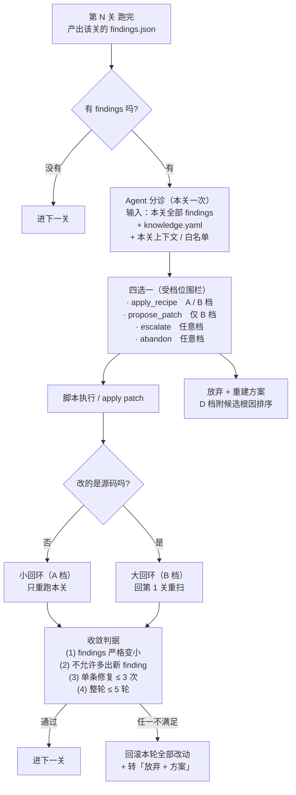
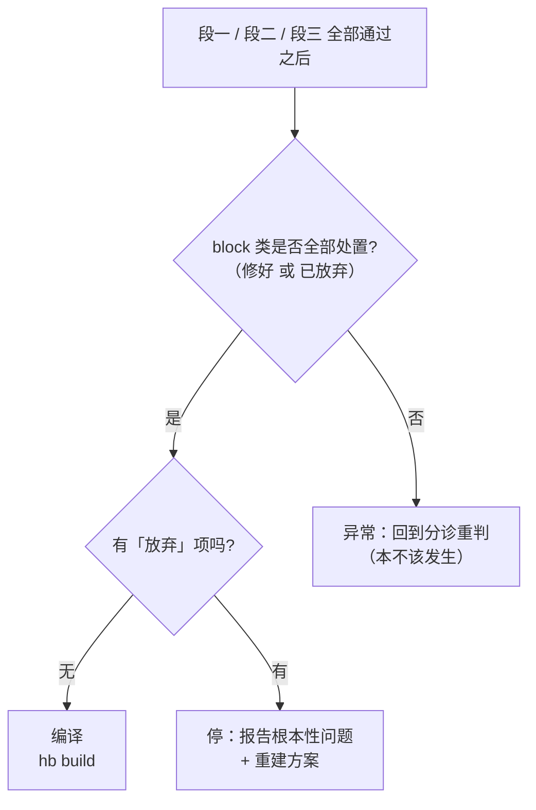

# 02 · 流水线与关

> **本文回答**：检查按什么顺序跑、每关查什么、为什么这么排。
> **对应**：原设计文档 §7（八关全图与分诊控制流）、§26（昂贵动作前置门）、§27（61 条逐条落点）。

[← 01 问题与论证](01-问题与论证.md) · [03 实现设计 →](03-实现设计.md)

---

## 7. 流水线：两段预检 + 八关

流水线不是一条，是**三段**——因为有三类昂贵动作，每类前面要一道门。

排序依据**不是一条原则，是三条**——缺一条都定不下位置：

| 原则                       | 说的是什么                                 | 决定                             |
| -------------------------- | ------------------------------------------ | -------------------------------- |
| **一 · 存在性**     | 一道门只能检查**此刻已经存在**的东西 | **最早能放多早**（硬下界） |
| **二 · 代价**       | 在昂贵动作之前，先花秒级成本确认它能成功   | **最晚该放多晚**（上界）   |
| **三 · 依赖正确性** | 前一步不通过时，后一步会产生**假报** | 区间内两门之间的相对顺序         |

```
每道门都有一个区间，位置 = 区间内由原则三定：

    最早 ──────────────── 最晚
     ↑                      ↑
   原则一                 原则二
  (硬下界)               (上界)
```

最初的设计只用了原则二，更早的版本甚至用的是「输入依赖」，所以把可达性推到了第 6 关——**结论碰巧对，理由错了**（见 26.1 与 26.5）。

### 7.0 先切一刀：61 条里 24 条不需要源码树

排序之前先问：**每条检查，需要什么才能查？**

| 类别                       | 条数 | 需要源码树吗                        | 依据                                                                                                                                                                                                                                                                                         |
| -------------------------- | ---: | ----------------------------------- | -------------------------------------------------------------------------------------------------------------------------------------------------------------------------------------------------------------------------------------------------------------------------------------------- |
| **E 外部网络**       |    6 | ❌ 完全不需要                       | 全在探端点。`ENV-001` 探 WSL 分发 CDN、`NET-003` 探 `storage.googleapis.com`、`NET-004` 探 Gitee——**这些端点在源码存在之前就已经在了**                                                                                                                                       |
| **A1 工具环境准备**  |   10 | ⚠️**5 条不需要**（+2 边界） | `ENV-003`(python)、`ENV-013`(timeout)、`IMG-001`(mkfs.vfat)、`IMG-002`(mcopy) 是纯基线工具；`ENV-009`(qemu/ninja/node) 的清单按产品走，产品在 `config.yaml` 里。**边界**：`BUILD-011`/`BUILD-018`（交叉编译器名）能不能提前，取决于 `config.yaml` 是否声明工具链前缀 |
| **A2 工具版本准确**  |    8 | ⚠️**7 条不需要**            | 全是「环境里装了什么版本」× 白名单。**例外**：`BUILD-002` 要跑 `hb env`，而 `hb` 来自 prebuilts → 需要树                                                                                                                                                                       |
| **C 文件目录/权限**  |    7 | ⚠️**5 条不需要**（+1 边界） | `ENV-006`(sudo)、`ENV-008`(dubious ownership)、`ENV-010`(BOM)、`ENV-011`(引号)、`NET-006`(FUSE 慢盘)。`BUILD-010` 需要 `out/`；`IMG-003` 的**权限前提**可提前，但完整判读要跑脚本                                                                                      |
| **B 目标代码不完整** |   10 | ✅ 全部需要                         | 定义就是「源码缺内容」                                                                                                                                                                                                                                                                       |
| **D 目标代码配置**   |   14 | ✅ 全部需要                         | 定义就是「配置声明错」                                                                                                                                                                                                                                                                       |
| **F 其他**           |    6 | ⚠️**1 条不需要**            | `ENV-014` 是环境；另 4 条要树；`SYNC-001` 是 sync 进行中的活性判读                                                                                                                                                                                                                       |

```
不需要源码树 ── 24 条  (39%)   确定
边界         ──  3 条          取决于 config.yaml 声明到什么程度
需要源码树   ── 33 条  (54%)
sync 进行中  ──  1 条  (SYNC-001)
                ─────
                 61
```

**将近四成的检查跟源码树毫无关系，却全被排在小时级的 `repo sync` 后面。**

> 逐条的落点见第 27 节的大表。

如果流水线不分门，一次典型失败长这样：

```
T+0:00   装 WSL、apt 装工具                      ✅ 3 分钟
T+0:03   repo sync 启动                          ← 小时级动作开始
T+3:00   sync 完成，开始扫描源码树
T+3:05   扫描发现：产品引用了 30 个 manifest 未声明的仓（BUILD-026）
T+3:05   探这 30 个仓可达性 → 12 个是 403          ← 本该在 T+0:03 前 3 秒发现
T+3:20   报告：Ubuntu 版本不在支持范围（ENV-002）    ← 本该在 T+0:00 前发现
T+3:25   报告：当前账号没有 sudo（ENV-006）          ← 本该在 T+0:00 前发现
T+3:30   报告：mcopy 没装（IMG-002）                ← 本该在 -1 层发现
```

**这五行报告里，只有第一行真的需要那 3 小时**——因为「源码引用了哪些仓」必须扫源码才知道。

### 7.1 代价阶梯

| 动作                                | 代价                      |
| ----------------------------------- | ------------------------- |
| DNS / TCP 探测                      | **秒级**            |
| `repo init`                       | 秒 ~ 分钟                 |
| apt 装工具                          | 分钟                      |
| **`repo sync`（上百个仓）** | **小时级**          |
| **补拉缺失仓**                | **小时级**          |
| **`hb build`（全量编译）**  | **小时 ~ 十几小时** |

**三个小时级动作，前面各该有一个秒级的门。**

### 7.2 流水线全图

```
【段一 · 第 -2 层】环境预检            跑在 Windows 侧，什么都不要
   探：WSL 分发源 / CDN / 代理 / apt 源
   ★查：Windows 侧 python 是不是商店 stub          ENV-007
   保护：装 WSL + apt 装依赖工具
        │
   ◇ 分诊：本层 findings → Agent（每层一次）        ← 见 7.2.1
        │  处置 → 重验本层；不通过则回滚 + 放弃
        │
   ▶ 动作：装 WSL、apt 装工具                      （分钟级）
        │
【段二 · 第 -1 层】获取预检            WSL，只要 manifest
   探：repo bootstrap 端点 + 每个 project 的 remote 端点
   算：仓数 × sync-j → 并发风险预测                  NET-004
   ★基线工具存在性（whitelist.yaml 清单，command -v）
   ★环境身份（OS / Python / Node 版本 vs 白名单）
   保护：repo sync
        │
   ◇ 分诊：本层 findings → Agent（每层一次）        ← 见 7.2.1
        │
   ▶ 动作：repo init → repo sync                   ← 小时级
        │
════════ 段三：原「八关」════════
        WSL，要完整源码树
        ★ 第 0 / 2 / 3 / 4 / 5 / 6 / 7 关，每关跑完都「逐关分诊」
          （每关一次 Agent 调用，见 7.2.1）
【第 0 关】树完整性门禁
   哨兵文件 + manifest 仓清单 + 固定提交比对
   为什么排最前：它是下面所有扫描器的输入。树不完整，扫出的清单也不完整
        │
【第 1 关】需求提取（扫描器）  ←──────────┐
   七个提取器并行 → 产出「需求清单」      │ 补提取器后
        │                                │ 回环重跑
【第 2 关】提取自检  ─────────────────────┘
   反向确认：源码树里有没有「没被任何提取器覆盖」的文件类型
   这是防「扫描器自己漏了」的哨兵
        │
【第 3 关】存在性验证（纯 command -v / test）
   工具（仅提取出的）· 仓 · 部件 · 文件 · 库 · 头文件
        │
【第 4 关】身份验证（存在 ≠ 对）
   工具链 triple · 真身路径 · 头文件搜索路径
        │
【第 5 关】一致性验证（集合运算）
   部件闭包 × 可用部件集合 → 缺失集
   架构名映射（target_cpu × Kbuild ARCH）
   使用集合 × 声明集合 → 缺口集
        │
【第 6 关】修复可达性（全部带超时）
   DNS → 连接 → 仓库权限，三档分层，区分状态码
   语义收窄：输入是第 3 关 + 第 5 关的缺失集，
             问的是「缺的这些补得上吗」
        │
【第 7 关】半静态（可选，唯一需要 gn gen 的一关）
   解析 .ninja 查重复输出规则、查测试聚合依赖边
        │
【第 8 关】报告
   「缺什么 + 出自哪一行 + 怎么补」
   第 4 / 5 关的「工具链 × 目标」并排成一节
════════════════════════════════
        │
   ◇ 出口检查：block 类是否全部处置完毕？
        │   有「放弃」项 → 停，输出重建方案，不编译
        │   全部修好     → 继续
        │
   ▶ 动作：补拉缺失仓                              ← 小时级
        │                                            第 6 关保护的就是它
   ▶ 动作：hb build                                ← 小时级
```

**第 -2 ~ 第 6 关零编译。** 第 7 关是唯一需要跑工具的，可跳过。

**这张图是「空间视图」**——什么在哪跑、要什么、保护谁。**「控制流视图」**（分诊怎么决策、闭环怎么转、什么时候该停）在下面 7.2.1。

### 7.2.1 图解：分诊与闭环控制流

上一张图是「什么在哪跑」。这一张是「**跑出问题之后怎么转**」。

**每个关跑完，该关的 findings 交给一次 Agent 分诊**；分诊出决定，脚本执行，执行完重验，不通过就回滚。



**出口：不是「findings 清零」，是「`block` 清零」。**



**两条读法：**

1. **`warn` / `info` 可以带着编译。** 出口卡在 `block` 上——因为 `warn` 里有一部分是 S1 的假阳性（19.3.7），要求清零等于要求修假问题。
2. **大回环是必须的。** B 档改了源码 → 需求清单本身变了（补了 `#include <cstdint>` 之后，S6 就不再产出那条 gap 需求）→ 只能回第 1 关重扫。**A 档没有这个问题**，所以小回环只重跑本关。

> **分诊的粒度为什么是「每关一次」**：三种粒度都试过——每条一次（一场预检几十次调用，其中一半是「缺个包」）、全局一次（丢掉了关与关的上下文，且不尊重原则三的顺序）、每关一次（8 次左右，每条 finding 都能拿到本关上下文）。**中间那个是对的。**

> **完整设计**（四档定义、根本性判据、Agent 的围栏、知识库的 `fix_recipe` 与自学习回路）见第 28 节。

### 7.3 三段各在哪跑

| 段                | 跑在哪                  | 需要什么            | 保护谁                               |
| ----------------- | ----------------------- | ------------------- | ------------------------------------ |
| 第 -2 层 环境预检 | **Windows 侧**    | 什么都不要          | 装 WSL / 装工具                      |
| 第 -1 层 获取预检 | WSL，**无源码树** | `repo` + manifest | `repo sync`（小时级）              |
| 第 0–8 关        | WSL，**有源码树** | 完整源码树          | 补拉缺失仓 +`hb build`（各小时级） |

第一行值得单独说：**环境预检是唯一必须在 Windows 上跑的部分**——因为那时 WSL 还不存在。

### 7.4 三个门吃的东西不一样

| 门         | 输入来源                       | 吃七个提取器吗 |
| ---------- | ------------------------------ | -------------- |
| 第 -2 层   | 无                             | ❌             |
| 第 -1 层   | manifest（**不是源码**） | ❌             |
| 第 0–8 关 | 完整源码树                     | ✅             |

**整条链上，只有最后一段用到了那套提取器。**

### 7.5 每关为什么这么排

| 关 | 位置依据（哪条原则）                                                                        | 跳过会怎样                         |
| -- | ------------------------------------------------------------------------------------------- | ---------------------------------- |
| -2 | **原则一**：这是唯一「WSL 还不存在」的时刻                                            | `ENV-001` 一发生，后面全跑不了   |
| -1 | **原则一**：只需 manifest；**原则二**：必须在 sync 前                           | **开一个注定会死的 sync**    |
| 0  | **原则三**：它是下面所有扫描器的输入                                                  | 树不完整时，扫描结果静默残缺       |
| 1  | **原则三**：需要完整树                                                                | —                                 |
| 2  | **原则三**：需要提取完成；且越早发现，重跑第 1 关的代价越小                           | 扫描器漏了文件类型，后面全都白查   |
| 3  | **原则三**：清单来自第 1 关                                                           | —                                 |
| 4  | **原则三**：对不存在的工具做身份检查会假报                                            | 假报「身份错误」                   |
| 5  | **原则三**：需要第 3 关的存在性通过                                                   | 缺失集里混入「根本没扫到」的噪声   |
| 6  | **原则一**：它探的集合（源码引用但 manifest 未声明的仓）在第 1 关之前**不存在** | `BUILD-026` 查不出补不补得上     |
| 7  | **原则三**：`gn gen` 要跑工具链，工具链身份得先在第 4 关验过                        | 图冲突是最后一道，前面错了查不出来 |
| 8  | —                                                                                          | —                                 |

> **第 6 关那一行要特别注意**：它的位置依据是**原则一，不是原则二**。
> 它探的那个集合受硬下界约束，秒级探针**物理上没法更早跑**。详见 26.5。

> 两段预检的细节（具体探什么、`NET-004` 的并发预测）见第 26 节。

---

## 26. 「昂贵动作前置门」原则与两段预检细节

> 本节展开第 7 节三段结构里**两段预检**的依据与细节。第 7 节的流水线图是最终形态，本节说明它为什么长这样。

### 26.1 为什么不能按「输入依赖」排

最初的版本按「**输入依赖**」排序：能算的先算，所以可达性排到了第 6（因为它的输入是第 3 关报出的缺失集）。

**这个原则是错的。** 正确的原则是：

> **按代价排序：在每个昂贵动作之前，先花秒级成本确认它能成功。**

按输入依赖排，得到的是「计算上最自然的顺序」；
按代价排，得到的是「**最省时间的顺序**」——而省时间正是这个工具存在的理由（第 1–2 节）。

### 26.2 代价阶梯

| 动作                                | 代价                      |
| ----------------------------------- | ------------------------- |
| DNS / TCP 探测                      | **秒级**            |
| `repo init`                       | 秒 ~ 分钟                 |
| apt 装工具                          | 分钟                      |
| **`repo sync`（上百个仓）** | **小时级**          |
| **`hb build`（全量编译）**  | **小时 ~ 十几小时** |

**两个小时级的动作，前面各该有一个秒级的门。** 最初只给了 `hb build` 一个门（八关），`repo sync` 一个都没有。

### 26.3 两段预检接在哪

完整形态见第 7 节的流水线图。要点是：**第 -2 层接在「装 WSL / 装工具」之前，第 -1 层接在「`repo sync`」之前，八关接在「`hb build`」之前。**

### 26.4 三个入口，因为它们跑在三个不同的环境

| 入口                      | 跑在哪                  | 需要什么            | 保护谁          |
| ------------------------- | ----------------------- | ------------------- | --------------- |
| `scan.py --stage env`   | **Windows 侧**    | 什么都不要          | 装 WSL / 装工具 |
| `scan.py --stage fetch` | WSL，**无源码树** | `repo` + manifest | `repo sync`   |
| `scan.py --stage tree`  | WSL，有源码树           | 完整源码树          | `hb build`    |

**第一行值得单独说**：环境预检是**唯一必须在 Windows 上跑的部分**——因为那时 WSL 还不存在。

这跟第 15.1 节那个决定是同一件事的延伸：**运行位置分层，与代码依赖分层一致。**

### 26.5 第 6 关为什么还在 6 —— 以及文档原来给的理由是错的

原来的「可达性验证」一名两用，容易让人以为它是网络总检。拆开后是**两趟不重叠的可达性检查**：

| 时机             | 名字                            | 探哪些端点                                      | 输入                      | 问的问题                                 |
| ---------------- | ------------------------------- | ----------------------------------------------- | ------------------------- | ---------------------------------------- |
| sync**前** | 获取预检（第 -1 层）            | manifest**声明了的** `<project remote>` | manifest                  | 这次 sync 要访问的端点，**通不通** |
| sync**后** | **修复可达性**（第 6 关） | 源码**引用了但 manifest 没声明的**仓      | 第 3 关 + 第 5 关的缺失集 | 缺的这些仓，**补得上吗**           |

**它们不重叠**，所以第 6 关省不掉。

#### 那么为什么还在 6？

⚠️ **本节原先写的理由是「输入是第 3 关的缺失集」——那正是 26.1 刚宣布为错误的「输入依赖」原则。结论对，理由错。**

真正的理由是**原则一（存在性）**：

> **第 6 关探的那个集合，在第 1 关跑完之前物理上不存在。**
>
> 「源码引用了哪些仓」要扫源码才知道。秒级探针在这里**没东西可探**。

这是**硬下界**，原则二（代价）管不了它——**当探针物理上没法更早跑时，代价原则失效。**

#### 第 6 关治的是什么病：repo 工具的能力边界

```
manifest.xml 里没有 third_party/asmjit
但 BUILD.gn 里写了 deps = ["//third_party/asmjit:asmjit"]
                    ↓
repo 的视野只有 manifest，看不到 BUILD.gn
                    ↓
repo sync 正常完成，退出码 0            ← 没有任何报错
                    ↓
hb build 跑了几小时后才发现 GN 加载不了    ← BUILD-026
```

**这就是为什么必须有一道专门的门**：`repo sync` 的成功退出码**不代表树是完整的**。

#### 两处修订（本节原来没写对）

1. **输入漏了第 5 关**。原文只写「第 3 关的缺失集」，但**第 5 关也产出缺失集**（部件闭包 → 缺失集、使用集合 × 声明集合 → 缺口集）。按原文，`BUILD-014`/`BUILD-021`/`BUILD-025` 找到的缺失部件**没人查可达性**。
2. **它保护的动作没画进流水线图**。原文图是「第 8 关 → `hb build`」，中间缺了「**补拉缺失仓**」（小时级）。不画出来，第 6 关看起来就是个没有下游的检查。

另加一条落地要求：**第 6 关的结果要持久缓存**。vendor 闭源仓是**永久不存在**的，每跑一次探一次是浪费——第一次的结果存下来带时间戳即可。

### 26.6 第 -1 层预检具体查什么

门槛极低：`repo init` 只要几秒，产出 `.repo/manifests/*.xml`，里面就有全部 `<project remote=...>`。**不需要源码就能算出这次 sync 要访问哪些端点。**

| 检查                | 做法                                           | 对应               |
| ------------------- | ---------------------------------------------- | ------------------ |
| `repo` 命令在不在 | `command -v repo`                            | `NET-003` 的前置 |
| bootstrap 端点可达  | 探`storage.googleapis.com`                   | `NET-003`        |
| 每个 remote 的 DNS  | `getent hosts <host>`                        | `NET-001` 类     |
| 每个 remote 的连接  | `curl -I --max-time 10`                      | —                 |
| 每个 remote 的权限  | 返回码判读（401/403 单列一档）                 | `SYNC-004`       |
| **并发风险**  | `<project>` 数 × `sync-j` vs 端点限流历史 | `NET-004`（429） |

**最后一行值得注意**：`NET-004` 的 Gitee 429 是**可以在 sync 前预测的**——manifest 里有仓数，`<default sync-j>` 里有并发数，两者相乘就是压给端点的瞬时压力。这条只能算启发式，标 `warn` 不标 `block`。

**预检全部带 `--max-time`**——`SYNC-001` 的教训：检查器自己不能挂住。

### 26.7 这个原则不止适用于可达性

「昂贵动作前置门」是**通用编排原则**，不是网络专用的。按它把 61 条重排：

| 昂贵动作                       | 前置门                                          | 覆盖条目                                                          |
| ------------------------------ | ----------------------------------------------- | ----------------------------------------------------------------- |
| 装 WSL 发行版                  | 端点可达（第 -2 层）                            | `ENV-001`、`NET-002`                                          |
| apt 装工具                     | apt 源可达（第 -2 层）                          | `NET-001`                                                       |
| **装完之后 / sync 之前** | **基线工具存在性 + 环境身份（第 -1 层）** | `ENV-002/003/004/005/007/009/013`、`IMG-001/002`、`ENV-014` |
| `repo init`                  | repo bootstrap 端点（第 -1 层）                 | `NET-003`                                                       |
| **`repo sync`**        | manifest 端点全量探测 + 并发风险（第 -1 层）    | `NET-004`、`SYNC-004`                                         |
| **补拉缺失仓**           | 第 6 关修复可达性                               | `BUILD-026`、`BUILD-023`、`SYNC-004`                        |
| **`hb build`**         | 第 0–5 关（本地静态）                          | `SYNC-002/003/005`、`BUILD-023/024/026` 及其余全部            |

**第 3 行是本次新增的**，它解决了一个原来被误以为无解的问题。看下面。

#### 工具清单的洞，以及它怎么被填上

本节原来的版本记过一条自我批评：

> 保护 `apt` 的门要一份**工具清单**——清单从哪来？**从源码树的 S1 提取**。但那时还没有源码树……
> → 所以这一格的清单只能来自配置里的 `whitelist.yaml`，**不能来自扫描**。
> → **这正是第 10 节「未声明的约束只能靠白名单」的又一个落点。**

**推理是对的，但结论漏了一步。** 既然清单在配置里就有，那么**检查本身也不必等第 3 关**。

工具存在性应该**拆成两层**：

| 层                     | 清单来源                   | 在哪查             | 例子                                                                                       |
| ---------------------- | -------------------------- | ------------------ | ------------------------------------------------------------------------------------------ |
| **基线工具**     | `whitelist.yaml`（配置） | **第 -1 层** | `clang`、`gn`、`ninja`、`python3`、`timeout`、`mcopy`、`mkfs.vfat`、`repo` |
| **提取出的工具** | 第 1 关 S1 扫描            | 第 3 关            | 源码里调用的、非基线的（如产品特有的交叉编译器）                                           |

**两个好处**：

1. `command -v` 是**秒级**，能拦住「apt 装完了但某个基线工具其实没装上」——**不用等几小时的 sync**。这就是 `ENV-003`(python)、`ENV-013`(timeout)、`IMG-001`(mkfs.vfat)、`IMG-002`(mcopy) 该在的位置。
2. **R8 不再是「无解」**：它本来就不需要声明来源——**配置里的基线清单就是它的来源**；而完整覆盖仍然靠第 3 关，两条腿不冲突。

#### 环境身份同理

`ENV-002`(Ubuntu 版本)、`ENV-004`(externally-managed)、`ENV-005`(Python 3.13) 三条，第 10 节说它们「**源码里没有任何一处声明，所以不可能被扫描器扫出来，只能靠白名单**」。

**但「扫不出来」不等于「查得晚」。** 恰恰相反——它们**不依赖源码树**，是全场最早能查的一类。原来放在第 4 关，是被「反正是白名单」这个性质连累了。

引擎位置：**第 -1 层的 `precheck/p_base.py`**。

> ⚠️ **`ENV-007` 是特例，它连第 -1 层都不够早。**
> 「Windows 商店 python stub」是 **Windows 侧**的现象。第 -1 层跑在 WSL 里，**PATH 里没有 Windows 的商店别名，查不到**。
> 它只能在**第 -2 层**——那是唯一在 Windows 侧的门。

### 26.8 对第 15.3 节的一个影响

原来只有三段（提取 / 验证 / 报告）。现在链上多了两段预检，中间产物也应分开：

```
env-precheck.json   ← 第 -2 层产出
fetch-precheck.json ← 第 -1 层产出
requirements.json   ← 阶段 A 产出（不变）
findings.json       ← 阶段 B 产出（+ 修复段回写 fix_status / attempts）
patches/            ← 阶段 D 产出（Agent 的出 patch，默认 dry-run）
report.md           ← 阶段 C 产出（不变）
```

**前三份互相不依赖**，可以各自单独跑、单独存档。这也让「上次 sync 时哪个端点慢了」这类历史对比成为可能。

---

## 27. 三原则与 61 条的落点

> 本节回答一个问题：**「六类归类」和「流水线分段」是什么关系？**
> 答案是：**它们正交**。类别按「根因是什么」分，段按「需要什么才能查」分。本节把 61 条逐条放到段上去。

### 27.1 位置公式

```
每道门都有一个区间：

    最早 ──────────────── 最晚
     ↑                      ↑
   原则一                 原则二
  (存在性，硬下界)      (代价，上界)

区间内的位置：原则三（依赖正确性）
```

| 原则                       | 一句话                                     | 违反的后果                                 |
| -------------------------- | ------------------------------------------ | ------------------------------------------ |
| **一 · 存在性**     | 一道门只能检查**此刻已经存在**的东西 | 门在跑，但没东西可查——**探针空转** |
| **二 · 代价**       | 在昂贵动作之前，先花秒级成本确认它能成功   | 花了几小时，才发现几秒就能查出的错         |
| **三 · 依赖正确性** | 前一步不通过时，后一步会产生**假报** | 报出一堆假的「身份错误」「缺部件」         |

**三条缺一条都定不下位置。** 第 6 关就是只有原则一能解释的例子（26.5）——它受硬下界约束，代价原则在此失效。

### 27.2 61 条逐条落点

#### 段一 · 第 -2 层（4 条）—— Windows 侧，什么都不要

| 编号        | 类 | 现象                             | 抓它的机制                                                          |
| ----------- | -- | -------------------------------- | ------------------------------------------------------------------- |
| `ENV-001` | E  | `Wsl/InstallDistro/0x80072f78` | 探 WSL 分发源 + Microsoft CDN                                       |
| `NET-001` | E  | apt 官方源超时                   | `getent hosts` + `curl -I --max-time` 探 apt 镜像源             |
| `NET-002` | E  | WSL 提示 localhost 代理未镜像    | 探宿主代理 + 检查 WSL 的 localhost 转发配置                         |
| `ENV-007` | A2 | 商店 python stub 命中 PATH       | Windows 侧对`python` 做身份判读（真身路径是不是 `WindowsApps`） |

#### 段二 · 第 -1 层（17 条）—— WSL，只要 manifest

**① 端点类（3）**

| 编号         | 类 | 现象                     | 抓它的机制                                               |
| ------------ | -- | ------------------------ | -------------------------------------------------------- |
| `NET-003`  | E  | repo 从 Google 下载失败  | `command -v repo` + 探 `storage.googleapis.com`      |
| `NET-004`  | E  | Gitee 429                | `<project>` 数 × `<default sync-j>` → 与限流历史比 |
| `SYNC-004` | E  | `arkui_ace_engine` 403 | manifest 每个 remote 探到「权限档」                      |

**② 环境身份 / 版本（4）**

| 编号        | 类 | 现象                                  | 抓它的机制                                   |
| ----------- | -- | ------------------------------------- | -------------------------------------------- |
| `ENV-002` | A2 | `OS version 26.04 is not supported` | `lsb_release -rs` vs 白名单                |
| `ENV-004` | A2 | `externally-managed-environment`    | 探系统 Python 的包管理策略                   |
| `ENV-005` | A2 | `No module named 'pipes'`           | `python3 -V` vs 白名单                     |
| `ENV-014` | F  | Node 14 + trace 目录缺失              | `node -v` vs 白名单（非阻塞，标 `info`） |

**③ 基线工具（4）**——清单来自 `whitelist.yaml`，不需要扫描

| 编号        | 类 | 现象                            | 抓它的机制               |
| ----------- | -- | ------------------------------- | ------------------------ |
| `ENV-003` | A1 | `env: 'python': No such file` | `command -v python`    |
| `ENV-013` | A1 | `timeout: command not found`  | `command -v timeout`   |
| `IMG-001` | A1 | `mkfs.vfat tool is not exist` | `command -v mkfs.vfat` |
| `IMG-002` | A1 | `mcopy tool is not exist`     | `command -v mcopy`     |

**④ 目标相关工具（1）**——清单按产品走，产品在 `config.yaml` 里

| 编号        | 类 | 现象                                           | 抓它的机制                                              |
| ----------- | -- | ---------------------------------------------- | ------------------------------------------------------- |
| `ENV-009` | A1 | `qemu-system-x86_64`/`ninja`/`node` 缺失 | 按`config.yaml` 的产品名取工具集，逐个 `command -v` |

**⑤ 权限 / 本地环境（4）**

| 编号        | 类 | 现象                                    | 抓它的机制                                                            |
| ----------- | -- | --------------------------------------- | --------------------------------------------------------------------- |
| `ENV-006` | C  | 无法安装系统包或`sudo` 卡住           | `id` + `sudo -n true`                                             |
| `ENV-008` | C  | `dubious ownership`                   | ⚠️**需 `repo init` 先建出 `.repo`** → 本层末尾，不是开头 |
| `ENV-010` | C  | BOM 导致`cd: command not found` | 检查传给 WSL 的脚本编码                                               |
| `ENV-011` | C  | 多层 shell 破坏引号                     | 检查**本工具自己的调用方式**（bat 纯 ASCII、复杂逻辑放服务端）  |

**⑥ 本地资源（1）**

| 编号        | 类 | 现象                       | 抓它的机制                                                            |
| ----------- | -- | -------------------------- | --------------------------------------------------------------------- |
| `NET-006` | C  | 构建被 SIGKILL、超时或极慢 | 探本地负载 + 挂载点类型（它在 C 类不在 E 类，正是因为它不是网络问题） |

#### sync 进行中（1 条）

| 编号         | 类 | 现象                          | 抓它的机制                                   |
| ------------ | -- | ----------------------------- | -------------------------------------------- |
| `SYNC-001` | F  | `Updating files` 长时间停留 | 活性判读：看进度有没有推进，不是「超时就杀」 |

#### 段三 · 第 0 关（2 条）

| 编号         | 类 | 现象                                  | 抓它的机制          |
| ------------ | -- | ------------------------------------- | ------------------- |
| `SYNC-002` | B  | `build.sh missing`                  | 哨兵文件            |
| `SYNC-003` | B  | `third_party/jsframework not exist` | manifest 仓清单对账 |

#### 第 1 关（0 条，但它是钥匙）

七个提取器不直接抓 61 条里的任何一条，它**造清单**。

**但 `BUILD-026` 的前半在这里**：S2 扫 `.gn` 里的 `//path` 引用——这一步产出的「源码引用了但 manifest 没声明」的仓集合，就是第 6 关的输入。

#### 第 2 关（0 条）

它抓的不是 61 条，是**扫描器自己**（见 19.8）。

#### 第 3 关（6 条）

| 编号          | 类 | 现象                                     | 抓它的机制                                                     |
| ------------- | -- | ---------------------------------------- | -------------------------------------------------------------- |
| `BUILD-001` | A1 | `genconfig: No such file or directory` | `command -v genconfig`（工具入口，非目标源码）               |
| `BUILD-008` | B  | `uint32_t does not name a type`        | S6 缺口（使用 × 声明）→ 头文件可达性                         |
| `BUILD-011` | A1 | 找不到`riscv32-unknown-elf-gcc`        | `command -v`（**工具名由 S4 从源码提取**，详见下方注） |
| `BUILD-017` | A1 | `cannot find -lnosys`                  | `$CC -print-file-name=libnosys.a`，找不到就原样回显          |
| `BUILD-018` | A1 | GN 找不到`csky-elfabiv2-gcc`           | 同`BUILD-011`                                                |
| `SYNC-005`  | A1 | prebuilts 没下完，GN/Ninja/hb 不可用     | `test -f` 对 prebuilts 关键文件                              |

> **`BUILD-011`/`BUILD-018` 是本表里唯一有争议的两条。**
> 交叉编译器的名字有两个来源：**S4 从源码提取**（`BUILD.gn` 里写的），或 **`config.yaml` 声明的工具链前缀**。
> 选前者就必须等树；选后者就能提到 -1 层。
> **本表按前者放**——保守，且与 S4 的设计一致。**这是一个可调的开关，不是一个定论。**

#### 第 4 关（3 条）

| 编号          | 类 | 现象                           | 抓它的机制                                   |
| ------------- | -- | ------------------------------ | -------------------------------------------- |
| `ENV-012`   | A2 | RISC-V32 命令实际链到 RISC-V64 | `-dumpmachine`（命令名说的和目标架构不符） |
| `BUILD-012` | A2 | `bash -lc` 重写 PATH         | `readlink -f "$(command -v $CC)"` 拿真身   |
| `IMG-004`   | A2 | `mformat -i file :` 报错     | 工具版本 vs 脚本预期语法                     |

#### 第 5 关（7 条）

| 编号          | 类 | 现象                                           | 抓它的机制                                                         |
| ------------- | -- | ---------------------------------------------- | ------------------------------------------------------------------ |
| `BUILD-003` | D  | `OHOS component : (drivers_tools) not found` | 部件闭包 × 可用部件 → 缺失集                                     |
| `BUILD-014` | D  | `wifi/appspawn/rust_libc/...` 连报不存在     | 同上                                                               |
| `BUILD-021` | D  | `ffrt/sqlite/rust_libc/...` 连报缺失         | 同上（闭包没覆盖新架构）                                           |
| `BUILD-025` | D  | `appexecfwk_core`/`runttime_core` 不存在   | 同上（旧名、拼写错、重复声明）                                     |
| `BUILD-024` | B  | LoongArch64 device 整体缺失                    | 同上（产品声明了但本地没有对应 device 仓）                         |
| `BUILD-030` | D  | `asm/orc_types.h` 缺失                       | 架构名映射：`target_cpu` × Kbuild ARCH（`x86_64` → `x86`） |
| `BUILD-020` | D  | overlay 合入后仍被 synthetic part 覆盖         | 使用集合 × 声明集合 → 缺口集                                     |

#### 第 6 关（2 条）

| 编号          | 类 | 现象                                          | 抓它的机制                                     |
| ------------- | -- | --------------------------------------------- | ---------------------------------------------- |
| `BUILD-026` | B  | GN 加载不了`third_party/asmjit`/`zydis`   | 对「源码引用了但 manifest 没声明」的仓探可达性 |
| `BUILD-023` | B  | RISC-V64 ANI/ETS 预编译 so 及 source 映射缺失 | 同上（制品不存在，也不是换架构就能补）         |

#### 第 7 关（2 条）

| 编号          | 类 | 现象                                             | 抓它的机制                      |
| ------------- | -- | ------------------------------------------------ | ------------------------------- |
| `BUILD-031` | D  | `multiple rules generate ... libmbedtls.aes.o` | 解析`.ninja` 查重复输出规则   |
| `BUILD-027` | D  | 关测试后仍从`mmi_tests` 聚合目标拉缺失服务     | 解析`.ninja` 查测试聚合依赖边 |

#### 语义提取 —— 第 8 节那一类（5 条）

不能从源码「推出」，要靠知识库判断：

| 编号          | 类 | 现象                                | 为什么扫描器推不出                                       |
| ------------- | -- | ----------------------------------- | -------------------------------------------------------- |
| `BUILD-004` | B  | `/bin/sh: 1: pushd: not found`    | 要判「shebang 声明 × 脚本实际用的语法」，是知识不是模式 |
| `BUILD-005` | B  | `/bin/sh: 1: shopt: not found`    | 同上                                                     |
| `IMG-005`   | B  | `mcopy` 覆盖失败                  | 要判「脚本漏了`-o`」，是流程完整性                     |
| `BUILD-022` | D  | `__exidx_start` 未定义            | 要判链接脚本缺`.ARM.exidx` 段，是领域知识              |
| `BUILD-028` | D  | Linux 6.6 缺目标架构 QEMU defconfig | 要判「内核版本 × 架构 × defconfig」这个组合存不存在    |

#### 需要运行期状态（5 条）

依赖「此刻的机器状态」，不是源码内容（第 11 节）：

| 编号          | 类 | 现象                                                     |
| ------------- | -- | -------------------------------------------------------- |
| `BUILD-007` | D  | `compiler type not set`（编译器变量没传到子 Makefile） |
| `BUILD-010` | C  | `./mksh is a directory`（`out/` 里同名目录占用路径） |
| `BUILD-019` | D  | 用产品目录名调用`build.sh` 后找不到产品                |
| `RUN-003`   | D  | 脚本进入错误分支（当前 product/board 与目标不一致）      |
| `IMG-003`   | C  | `qemu_run.sh -f` 需要 sudo 操作 losetup/mount          |

> `IMG-003` 的**权限前提**（有没有 sudo）其实在 -1 层就能查（同 `ENV-006`）；
> 完整判读要跑脚本，所以整条留在这里。

#### 结果判读（7 条）

只能读结果，硬编检查会造假（第 11 节）：

| 编号          | 类 | 现象                                                                   |
| ------------- | -- | ---------------------------------------------------------------------- |
| `BUILD-002` | A2 | `hb env` 报 `'int' object is not subscriptable`（要跑 `hb env`） |
| `BUILD-006` | F  | `Makefile: missing separator`（根因仍有 A1/B/D 多个候选）            |
| `BUILD-009` | B  | `cp: cannot create ... include/sys`（脚本漏 `mkdir -p`）           |
| `BUILD-015` | F  | Ninja 摘要说某个`.o` 失败但 `error.log` 无诊断                     |
| `BUILD-016` | F  | 构建成功但有无效警告                                                   |
| `BUILD-029` | D  | VDSO 汇编`junk at end of line`（LLVM/LLVM_IAS/汇编器参数不一致）     |
| `NET-005`   | F  | `npm install error with three times`（网络 vs 目录，候选未定）       |

### 27.3 从「六类」到「三段」的桥

把 61 条按段汇总：

| 段                         |         条数 | 占比 | 需要什么             |
| -------------------------- | -----------: | ---: | -------------------- |
| 段一 · 第 -2 层           |            4 |   7% | Windows 主机         |
| 段二 · 第 -1 层 + sync 中 |           18 |  30% | WSL（+ manifest）    |
| 段三 · 第 0–7 关         |           22 |  36% | **完整源码树** |
| 语义提取（第 8 节）        |            5 |   8% | 树 + 知识库          |
| 运行期 / 判读（第 11 节）  |           12 |  20% | 跑起来才知道         |
| **合计**             | **61** | 100% |                      |

**关键读法**：**段一 + 段二 = 22 条（36%）**，全都排在 `repo sync` 之前。

#### 两个维度是正交的

**类别按「根因是什么」分，段按「需要什么才能查」分。** 所以有些条目的类和段会错开：

| 编号          | 类            | 段                  | 为什么会错开                                                              |
| ------------- | ------------- | ------------------- | ------------------------------------------------------------------------- |
| `BUILD-002` | A2（版本）    | 结果判读            | 根因是版本组合，但**查法**是跑 `hb env`，而 `hb` 要等 prebuilts |
| `ENV-008`   | C（权限）     | -1 层**末尾** | 根因是所有权，但**必须先有 `.repo` 才能查**（原则一）             |
| `NET-006`   | C（本地资源） | -1 层               | 它被从 E 类踢出来，正因为**它不是网络问题**                         |
| `IMG-003`   | C（权限）     | 运行期              | 权限前提可提前，**完整判读要跑脚本**                                |
| `ENV-007`   | A2（版本）    | **-2 层**     | 现象在 Windows 侧，**只有那一道门查得到**                           |

**这五条说明：「归到哪一类」不决定「排在哪一关」。** 前者是知识组织方式，后者是执行编排方式。

### 27.4 覆盖不到的

按上面落点，**22 条（36%）在 sync 前拦掉，22 条（36%）在八关拦掉，剩下 17 条（28%）靠语义提取 + 运行期 + 判读**。

后 17 条不是「还没实现」，是**方法上就覆盖不了**：

- **语义提取（5 条）**：判据在知识库里，不在源码模式里（第 8 节）
- **运行期状态（5 条）**：依赖「此刻的机器状态」（第 11 节）
- **结果判读（7 条）**：硬编检查会造假，只能读结果（第 11 节）

**这三类的共同点：都不是「扫一遍源码」能回答的问题。** 承认它们的代价，比假装覆盖了要好——这就是 R2 和 R6 那两条「方法本身的边界，不是实现缺陷」的具体化。

---
